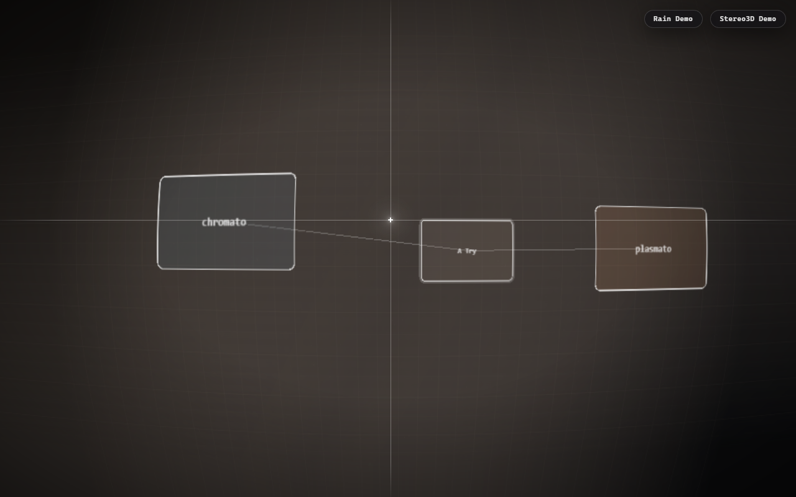
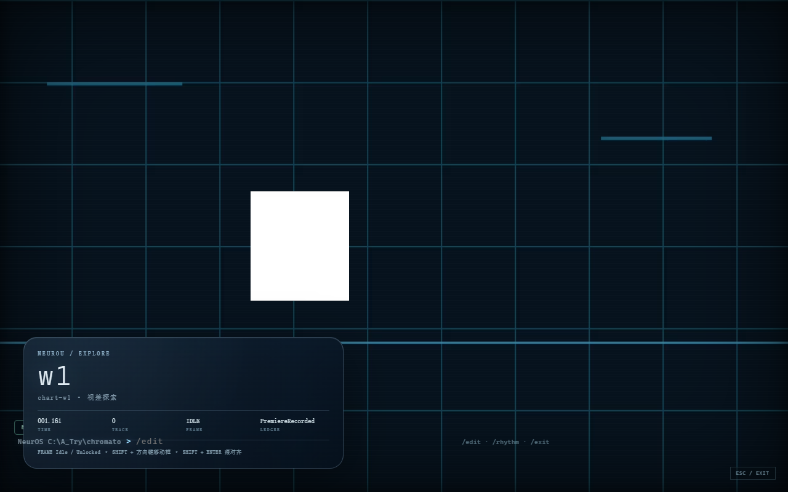
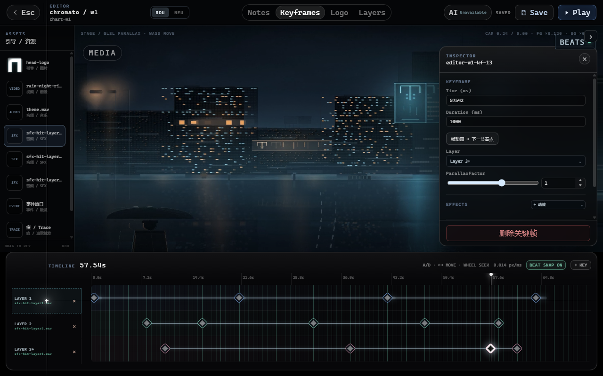

# neurou : when as a world

> *Yǔruò* — when a world becomes a world.  
> An experimental desktop world editor and procedural-phenomenology runtime.

<p align="center">
  <a href="https://github.com/ColFumice/neurou-when-as-a-world/actions/workflows/ci.yml"></a>
  <a href="https://github.com/ColFumice/neurou-when-as-a-world/releases/tag/v4.0.0"></a>
  
  
  
</p>

<p align="center">
  <a href="https://colfumice.github.io/neurou-when-as-a-world/">Live demo</a> ·
  <a href="https://github.com/ColFumice/neurou-when-as-a-world/releases/tag/v4.0.0">Release v4.0.0</a> ·
  <a href="README.md">中文</a>
</p>



## Version

**v4.0.0** — frozen at **R5c-B-patch**.

| Version | Scope |
|---|---|
| **v4.0.0** | Tauri 2 world / editor / game; R5c-A (Layer 3+, Layer Audio, mono-to-stereo, editor selection/group drag); R5c-B (Explore → Rhythm → Cutscene, NEU control, premiere ledger); R5c-B-patch (one-shot `?mode=rhythm`) |
| R5c-C | C0 plan only; the four AI tasks are not implemented in this release |

## What it is

`neurou : when as a world` is a desktop world editor and a procedural-phenomenology runtime:

- **World**: parallax stage, rain, traces, visual frame, NEU node graph.
- **Editor**: timeline keyframes, Layer 3+, beat grid, multi-select / group drag, Layer Audio.
- **Game**: Explore by default; NEU control enters Rhythm; Rhythm completion returns to Explore.
- **Media**: stereo/mono parallax, 20–50 ms integer-frame pseudo-stereo, audio and SFX.
- **Ledger**: one premiere per chart, single-writer semantics.

It is not a general-purpose game engine. It treats the *conditions of experience* as editable,
replayable and testable constraints.

## Live demo

**GitHub Pages**: <https://colfumice.github.io/neurou-when-as-a-world/>

The Pages build is a **static project-tree / world-entry showcase**. The full editor, media import,
Tauri filesystem and game runtime require the desktop app or a local Tauri run.

Static package:

```bash
python -m http.server 4173 --directory release/neurou
# http://127.0.0.1:4173/
```

Release asset: `neurou-v4.0.0-web.zip`.

## Screenshots

| Explore | Editor |
|---|---|
|  |  |

## Quick start

Requirements: Node.js **22+**, npm, Rust stable + WebView2 (desktop), ffmpeg (media import).

```bash
npm ci
npm --prefix v4/app ci

npm run typecheck:v4
npm run check:v4
npm run test:v4

# desktop dev
npm --prefix v4/app run tauri dev

# static web build
npm --prefix v4/app run build

# Rust media commands
cd v4/app/src-tauri && cargo test
```

## Architecture

```text
v4/core/       pure logic: chart, judgement, EditorWorldFile, NEU runtime, ledger
v4/adapters/   Tauri adapters: project IO, media import, AI HTTP, key store
v4/app/        React 19 + Vite editor/game shell + Tauri 2 backend
  src/editor   timeline, media, Layer Audio, AI panel
  src/game     Explore / Rhythm / Cutscene, Rain, Trace, Frame
  src-tauri    Rust media/file commands and capabilities
assets/        Cocos Creator 3.8.8 resources and legacy runtime assets
release/       static web release package
```

Frozen boundaries:

- R4a.1 judgement math (`judge.ts` / `note.ts` / `grid.ts` / `ChartScore`);
- `AudioOutputClock`;
- `ChartPremiereDirector`;
- R4f single ledger writer;
- AI produces proposals only; it never writes editor/chart/ledger automatically.

## Implemented in v4.0.0

- **R5c-A**: Layer 3+ full-screen judgement, 220/440/880 Hz Layer Audio SFX, integer-frame mono-to-stereo, beat grid / Beat Snap / Ctrl+A / group drag.
- **R5c-B**: orthogonal GameMode state machine; Explore by default; NEU `EnterRhythmMode / PlayCutscene / ExitToExplore`; lazy Rhythm clock/snapshot; premiere only on natural completion; Cutscene v1.
- **R5c-B-patch**: one-shot `?mode=rhythm`; `closeGame` / editor return resets Explore and clears sessionStorage.

R5c-C AI tasks (Rhythm / Narrative / Parallax / SceneVision) are **not implemented**;
only the C0 contract plan exists.

## Tests

| Item | Result |
|---|---|
| TypeScript unit tests | **442 / 442** |
| Rust | **35 / 35** |
| Asset checks | **84 / 84** |
| Legacy e2e | **9 / 9** |
| R5c-B e2e | **3 / 3** |
| Judgement core | unchanged, green |

## Version & release

- Version: **v4.0.0**
- Tag: `v4.0.0`
- Static package: `release/neurou/`
- Release asset: `neurou-v4.0.0-web.zip`

## Known limitations

- GitHub Pages is a static showcase; full editing/gameplay requires the Tauri desktop backend.
- R5c-C AI tasks are not in production code in this release.
- Media import / mono-to-stereo requires ffmpeg.
- This release ships a static web package; Tauri desktop bundling is disabled.
- The repository contains Cocos Creator 3.8.8 legacy assets and local verification records;
  generated binaries are mostly excluded.

## Contributing

Issues and PRs are welcome. Run:

```bash
npm run typecheck:v4 && npm run check:v4 && npm run test:v4
npm --prefix v4/app run build
```

See [CONTRIBUTING.md](CONTRIBUTING.md).

## License

[MIT](LICENSE) © 2026 ColFumice

---

**neurou : when as a world** — a world takes shape only when the rain begins.
