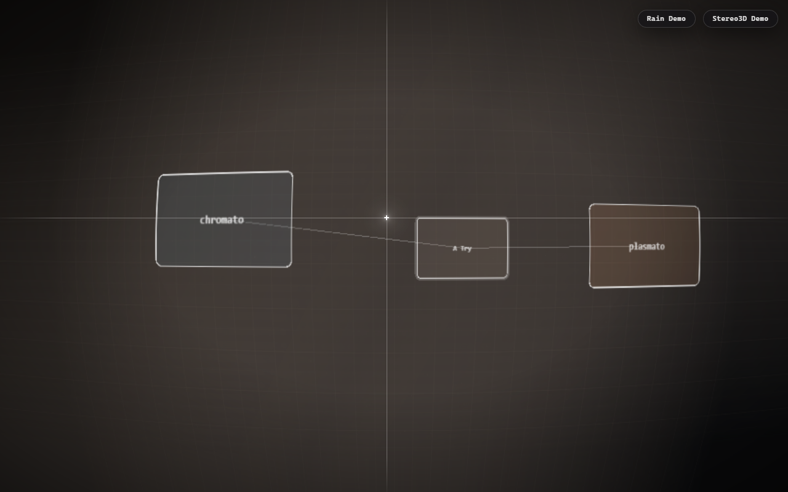
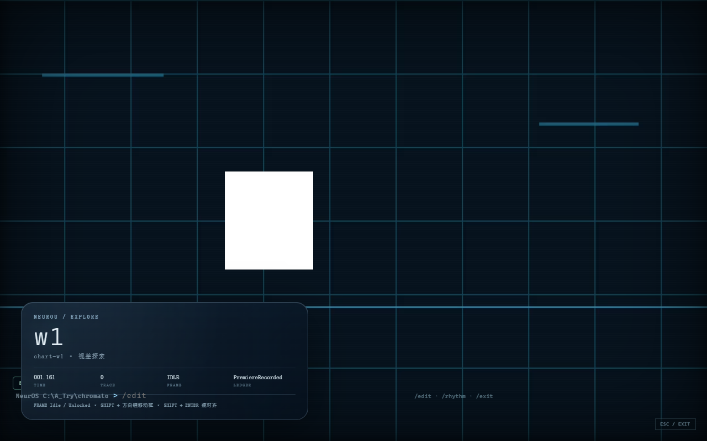
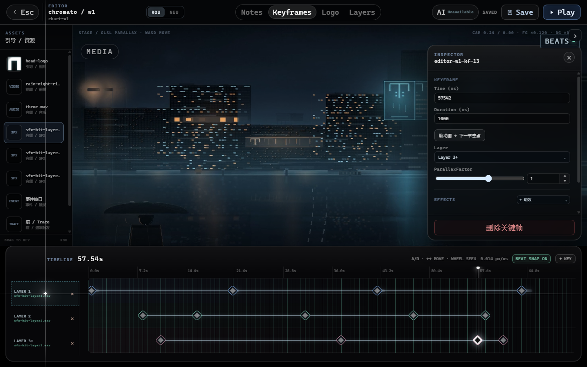

# neurou : when as a world

> 雨若：当世界成为世界。  
> 一个把「现象学约束」做成可编辑世界、可演奏谱面与可运行游戏的实验性系统。

<p align="center">
  <a href="https://github.com/ColFumice/neurou-when-as-a-world/actions/workflows/ci.yml"></a>
  <a href="https://github.com/ColFumice/neurou-when-as-a-world/releases/tag/v4.0.0"></a>
  
  
  
</p>

<p align="center">
  <a href="https://colfumice.github.io/neurou-when-as-a-world/">在线演示</a> ·
  <a href="https://github.com/ColFumice/neurou-when-as-a-world/releases/tag/v4.0.0">Release v4.0.0</a> ·
  <a href="README.en.md">English</a>
</p>



## 当前版本

**v4.0.0** — 冻结至 **R5c-B-patch**。

| 版本 | 内容 |
|---|---|
| **v4.0.0** | Tauri 2 世界/编辑器/游戏；R5c-A（Layer 3+、Layer Audio、单目转双目、编辑器多选/组拖拽）；R5c-B（Explore → Rhythm → Cutscene、NEU 控制、首演账本）；R5c-B-patch（一次性 `?mode=rhythm`） |
| R5c-C | 仅完成 C0 计划，四类 AI 任务尚未实现，未计入本版本 |

## 这是什么

`neurou : when as a world` 是一个桌面端的**世界编辑器 + 程序化现象学运行时**：

- **世界**：视差舞台、雨、痕（Trace）、视觉框（Frame）、NEU 节点图；
- **编辑器**：时间轴关键帧、Layer 3+、节拍网格、多选/组拖拽、Layer Audio；
- **游戏**：默认 Explore 探索，NEU 控制触发 Rhythm 音游，完成后回 Explore；
- **媒体**：双目/单目视差、单目 20–50ms 伪双目、音频与 SFX；
- **账本**：首演记录只写一次，保持单写者语义。

它不是通用游戏引擎，也不是 AI 生成游戏的“一键按钮”。  
它是把「体验的构成条件」拆成可编辑、可回放、可验收的约束系统。

## 在线演示

**GitHub Pages**：<https://colfumice.github.io/neurou-when-as-a-world/>

Pages 提供**项目树 / 世界入口的静态演示**。完整的编辑器、媒体导入、Tauri 文件系统与游戏运行需要下载桌面版或本地运行；浏览器没有 Tauri 的后端命令。

静态发布包位于 `release/neurou/`，可直接用任意静态服务器打开：

```bash
python -m http.server 4173 --directory release/neurou
# http://127.0.0.1:4173/
```

Release 资产：`neurou-4.0.0-web.zip`（同一静态包）。

## 截图

| Explore | 编辑器 |
|---|---|
|  |  |

## 快速开始

要求：

- Node.js **22+**
- npm **10+**
- Rust stable + WebView2（桌面 Tauri）
- ffmpeg（媒体导入 / 单目转双目）

```bash
npm ci
npm --prefix v4/app ci

npm run typecheck:v4
npm run check:v4
npm run test:v4

# 桌面开发
npm --prefix v4/app run tauri dev

# Web 静态构建
npm --prefix v4/app run build
```

Rust 媒体命令：

```bash
cd v4/app/src-tauri
cargo test
```

## 架构

```text
v4/core/       纯逻辑：谱面、判定、EditorWorldFile、NEU runtime、账本
v4/adapters/   Tauri 适配器：项目 IO、媒体导入、AI HTTP、KeyStore
v4/app/        React 19 + Vite 编辑器/游戏壳 + Tauri 2 后端
  src/editor  时间轴、媒体、Layer Audio、AI 面板
  src/game    Explore / Rhythm / Cutscene、Rain、Trace、Frame
  src-tauri   Rust 媒体/文件命令与 Tauri capability
assets/       Cocos Creator 3.8.8 资源与旧运行时素材
release/      静态 Web 发布包
```

关键冻结边界：

- R4a.1 判定数学：`judge.ts` / `note.ts` / `grid.ts` / `ChartScore` 不改；
- `AudioOutputClock` 不改；
- `ChartPremiereDirector` 不改；
- R4f 账本单写者不改；
- AI 只产生 proposal，不自动写 editor/chart/ledger。

## 已实现（截至 v4.0.0）

- **R5c-A**：Layer 3+ 全屏判定、Layer Audio 220/440/880Hz SFX、单目整数帧伪双目、节拍网格 / Beat Snap / Ctrl+A / 组拖拽。
- **R5c-B**：GameMode 正交状态机；默认 Explore；NEU `EnterRhythmMode / PlayCutscene / ExitToExplore`；Rhythm 懒建 clock/snapshot；自然完成写首演，中途退出不写；Cutscene v1。
- **R5c-B-patch**：`?mode=rhythm` 一次性 debug；`closeGame` / 编辑器返回重置 Explore 并清 sessionStorage。

R5c-C AI 四任务（Rhythm / Narrative / Parallax / SceneVision）**尚未实现**；当前只有 C0 统一契约计划。

## 测试状态

| 项 | 结果 |
|---|---|
| TypeScript 单测 | **442 / 442** |
| Rust | **35 / 35** |
| 资产校验 | **84 checks PASS** |
| 旧 e2e | **9 / 9**（含二次重进显式 `?mode=rhythm`） |
| R5c-B e2e | **3 / 3**（explore / mid-exit / cutscene） |
| 判定核心 | 未修改，全绿 |

```bash
npm run typecheck:v4
npm run check:v4
npm run test:v4
npm --prefix v4/app run build
cd v4/app/src-tauri && cargo test
```

## 版本与发布

- 当前版本：**v4.0.0**
- Git tag：`v4.0.0`
- 静态包：`release/neurou/`
- Release 资产：`neurou-4.0.0-web.zip`

发布流程由 `.github/workflows/release.yml` 在 `v*` tag 上构建并附加静态包。

## 已知限制

- GitHub Pages 是静态项目树展示；完整编辑器与游戏依赖 Tauri 桌面后端。
- 当前工作区没有把 R5c-C 的四类 AI 任务实现进生产代码；C0 计划见 `quality-review/stage-5/r5c-c/`（若存在）。
- 媒体导入与单目转双目需要本机 ffmpeg。
- 当前发布为 Web 静态包；Tauri 桌面安装包未启用 bundle。
- 仓库包含 Cocos Creator 3.8.8 旧资源与本地验收记录；生成物已尽量排除。

## 贡献

欢迎 Issue 与 PR。提交前请运行：

```bash
npm run typecheck:v4 && npm run check:v4 && npm run test:v4
npm --prefix v4/app run build
```

详见 [CONTRIBUTING.md](CONTRIBUTING.md)。

## License

[MIT](LICENSE) © 2026 ColFumice

---

**neurou : when as a world** — 雨落下来时，世界才开始有形状。
